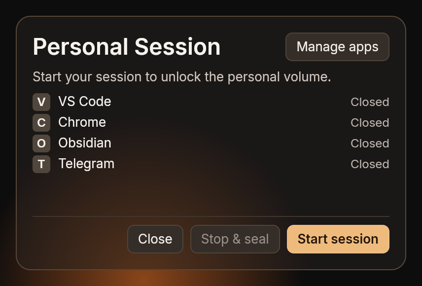
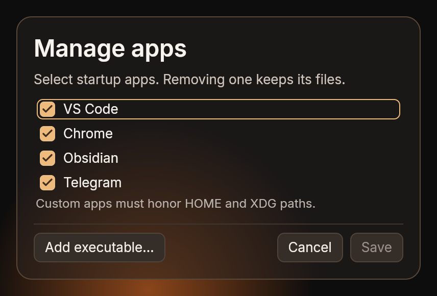

# Personal Session

Open a VeraCrypt volume and launch dedicated app profiles on Hyprland’s `special:special` workspace. The same panel closes their windows, checks for processes holding the volume open, and reports whether VeraCrypt dismounted it.



## Requirements

The downloadable x86_64 Linux build targets glibc 2.44 or newer. It was built on Manjaro. Other GNU/Linux systems can build from source. The panel uses Rune and Vulkan. Session control requires a running Hyprland session with Lua dispatch support, Kitty, VeraCrypt, sudo, getent, GNU coreutils, findmnt and fuser. Install the apps you enable. The supported launchers include `/usr/bin/code`, `/usr/bin/google-chrome-stable`, `/usr/bin/obsidian` and Telegram Desktop.

## Install

For the app editor on this branch, build from source using the instructions below. The v1.0.0 release predates the editor.

For v1.0.0, download the tarball and SHA256SUMS from the [release page](https://github.com/amir-seraj/personal-session/releases/tag/v1.0.0). Run these commands in the download directory.

```sh
sha256sum -c SHA256SUMS
tar -xzf personal-session-1.0.0-x86_64-linux-gnu.tar.gz
cd personal-session-1.0.0-x86_64-linux-gnu
sudo ./install.sh
```

### Prepare the volume

Use a dedicated, dismounted VeraCrypt file container with a Linux filesystem supporting Unix ownership. The helper uses the standard PIM, an empty keyfile list and no hidden-volume protection. It changes ownership of the mounted filesystem root to the desktop user. For a new installation, run the following as that user, replacing the example source path. The copy can require as much disk space as the container.

```sh
uid=$(id -u)
base="/var/lib/personal-session/$uid"
sudo install -d -o root -g "$(id -gn)" -m 0750 "$base"
sudo install -d -o root -g root -m 0755 "$base/open"
# Use a fresh destination. An existing container must be preserved.
sudo sh -c 'test ! -e "$2" && install -o root -g root -m 0600 "$1" "$2"' sh /path/to/dismounted-volume.hc "$base/volume.hc"
```

Administrators can override both paths in `/etc/personal-session/<uid>.json` with the keys `container` and `mount`. Use absolute paths without whitespace. The file, storage paths before unlock, and their parent directories must be root-owned, with no symlinks or group/world write access.

Use `sudo visudo -f /etc/sudoers.d/personal-session` to grant the desktop user access to the two installed helpers. Replace `YOUR_LOGIN` with the output of `id -un`. Keep the empty argument lists. VeraCrypt still prompts for the volume password.

```sudoers
YOUR_LOGIN ALL=(root) NOPASSWD: /usr/local/bin/personal-mount "", /usr/local/bin/personal-umount ""
```

### Choose apps



Open **Personal Session → Manage apps** while the volume is sealed. Check the apps you want at startup. To add another GUI app, choose **Add executable** and select its executable file. The file picker uses Zenity or KDialog. Save to apply the selection, or cancel to discard it. Removing an app leaves its profile on the volume. An empty selection is valid; add an app before starting the next session.

VS Code, Chrome, Obsidian and Telegram have dedicated launch settings. For a custom executable, the launcher runs the file directly with no arguments and gives it private HOME, XDG config, data, cache, state and temporary directories under the mounted volume. Choose a trusted executable that opens its own window and supports these directories. Apps that forward to another running instance or require desktop-launch arguments may fail the readiness check. These directories provide profile separation, not a security sandbox.

You can also edit `~/.config/personal-session/config.json` while the session is sealed. Built-in IDs and absolute executable paths can appear together. For Obsidian, set `vault` to an existing directory inside the volume containing a `.obsidian` directory. The default is `Vault`.

```json
{"apps":["chrome","/usr/bin/kitty"],"vault":"Vault"}
```

## Use

Open **Personal Session** in the application menu. **Start** opens the password prompt in Kitty. The configured profiles launch on the scratchpad. Use your Hyprland shortcut for that workspace. To close, save your work and use the panel’s stop action. If an app needs confirmation or another process holds the volume, resolve the prompt or release the file and retry.

| Command | Action |
| --- | --- |
| `personal-start` | Start from a terminal |
| `personal-start --status` | Report session readiness |
| `personal-stop --check` | Inspect session windows and processes |
| `personal-stop --cli` | Close the session from a terminal |
| `personal-session` | Open the panel |

## Build and uninstall

From the checkout, run `bash scripts/package.sh` with a recent stable Rust toolchain, Git, Python 3, GNU tar, Bash and a C/C++ build toolchain installed. It runs the release tests and writes the archive and checksum under `dist/`. Dependencies are pinned in Cargo.lock. The released binaries include Rune’s default fonts. WhiteSur icons are optional and loaded from an existing local installation.

Run `sudo /usr/local/lib/personal-session/v1.0.0/uninstall.sh` to remove the program and menu entry. Then remove its two sudoers grants with visudo. The volume and user configuration stay on disk.

Personal Session is distributed under the [MIT license](LICENSE). The binary archive includes third-party license notices. See [Rune](https://github.com/anomalyco/rune) for the renderer and [WhiteSur](https://github.com/vinceliuice/WhiteSur-icon-theme) for optional icons.
